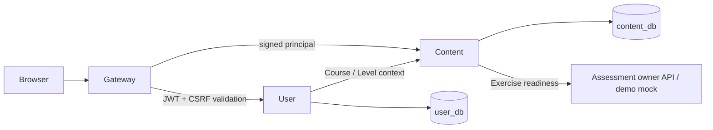

# Architecture / implementation decisions — 13/10/2026

Gateway has no business database. Internal paths require caller-specific RS256 service identity and allowlists. A user JWT alone does not authorize internal API. Gateway drops incoming identity headers, checks the current account/revocation on every protected request, then issues a short-lived method/path/audience-bound principal assertion. Services check role and ownership. No success cache, cross-database FK/SQL/write or invented completion by GET.

Deployable roots are backend/services/user-service/, backend/services/learning-content-service/ and backend/api-gateway/. Each has a standalone Spring Boot parent POM, local wrapper, Dockerfile and Compose configuration. Each Docker image contains one app.jar and only owner business classes. Shared infrastructure helpers are explicit vendored snapshots of shared/platform-core; they contain no business entities/repositories and require no sibling build/install. SDK drift is checked, and snapshots update explicitly. Root Compose is an integration overlay retaining existing database volume names, not a required service build context.

Authentication: email identity, BCrypt cost 12, access JWT default 30 minutes, no refresh. HttpOnly host-only access_token cookie at /api/v1, SameSite=Lax, Secure under HTTPS. JDBC CSRF session rotates on login, binds jti and absolute JWT expiry, logout persists revoked jti before clearing cookies/session. Explicit configured Origin is required on mutations. Anonymous CSRF session has 15-minute idle expiry. User owns both session tables.

Owner-client connections: connect 2s/read 5s, no automatic mutation retry. Lesson publish and learning reads validate the Assessment response (lessonId/ready/exerciseId/questionCount). Mock is a separate demo service; production dependency failure is 503. Local transactions do not claim distributed consistency: visibility/readiness may change after remote validation. A future integration with Assessment/Progress must respect attempt snapshots and original completion semantics.

JPA entities validate the schema; owner JDBC adapters use bound SQL parameters and TransactionTemplate for writes. HTTP DTOs never serialize entities/password hashes/tokens. PostgreSQL constraints resolve uniqueness races. Parent links are immutable in public API. Unpublish changes availability and retains saved references/history owned elsewhere.

Listening: configure trusted public HTTPS hosts; no file/media upload feature. Validation rejects userinfo, custom ports, private/local IPs and redirects. Availability uses a bounded HEAD probe and audio Content-Type; failed resource check marks that item UNAVAILABLE, not a fake successful audio stream. Trusted hosts must be operator-controlled; outbound DNS/egress restrictions should be enforced in deployment to supplement application checks.

Review pending: API-06 keys/rotation/network/CSRF integration, API-09 DTO mapping, API-10 Level supply, API-12 media adapter. Fixed TTLs/algorithm are implementation choices, not inferred team decisions. W3-01/02/03/06 stay under their actual reviewers' acceptance process.
