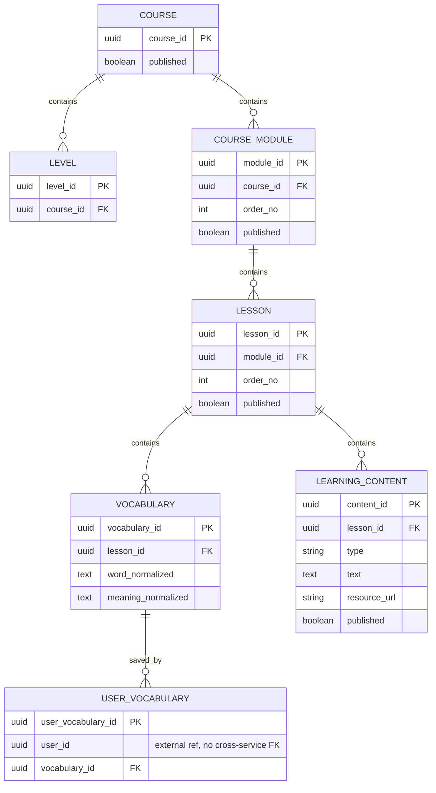

# Content physical ERD — artifact review #20

Nguồn: migration Content tại Khoa `bf183461e5647ad83c7ec16dc6c7d1953379b10e`.
Hình PNG cùng thư mục được tạo từ cùng quan hệ để bổ sung Word W3-03 local.
Đây là đối chiếu source; chờ Khoa/Huy review, không phải xác nhận baseline mới.

Mỗi child có đúng một parent local; parent có thể chưa có child, nên cardinality
là 1 → 0..*. UNIQUE Vocabulary: (lesson_id,word_normalized,meaning_normalized).
UNIQUE saved relation: (user_id,vocabulary_id). GRAMMAR/READING bắt buộc text;
LISTENING bắt buộc resource_url; availability là DTO derive. Không có Level→Module
FK hoặc FK User xuyên database. Đây là subset fields phục vụ diagram; SQL migration
là nguồn đầy đủ về columns/checks/index/grants.
