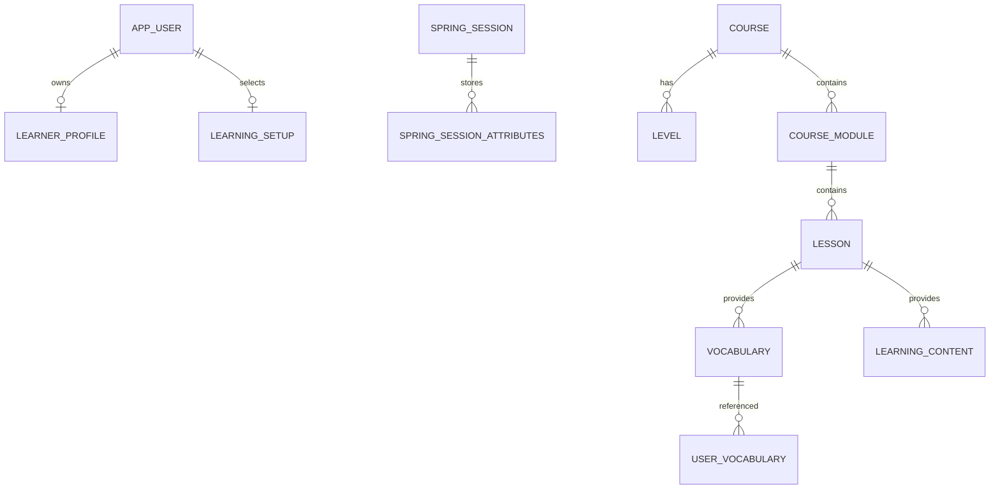

# Database ERD

USER_VOCABULARY.user_id is external to Content, not an FK to User DB. LEARNING_SETUP.current_course_id/current_level_id are external to User. REVOKED_TOKEN has no cross-service relationship.
