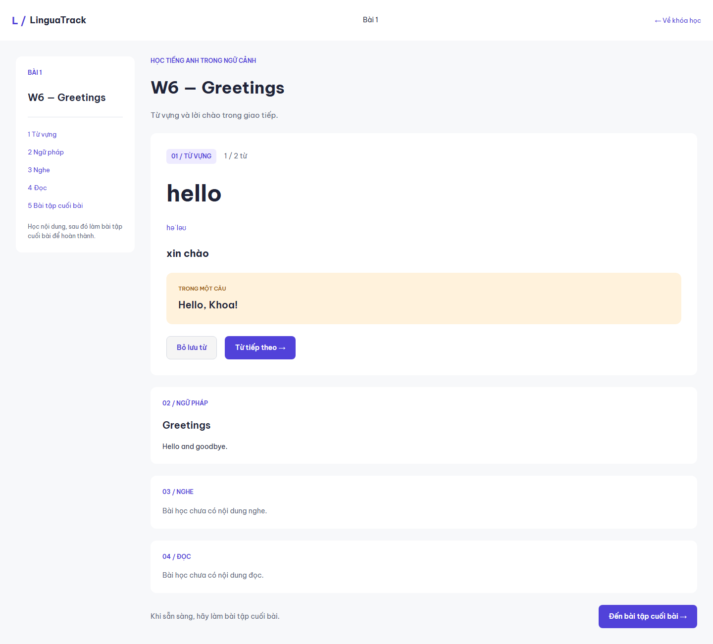
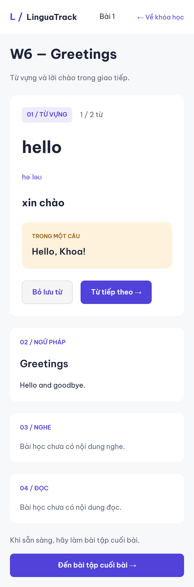

# Frontend evidence — 27/10/2026 (giờ Việt Nam)

**Quy trình cập nhật cùng ngày:** bỏ CI/CD theo yêu cầu Hưng; hai workflow repository đã tắt. Chạy lại thủ công `npm run check` PASS (14 unit/UI, lint/build/contract guard) và `npm run test:e2e` PASS (6 MOCK) sau thay đổi tài liệu/workflow; code nghiệp vụ không đổi. Hai LIVE tests trong bảng bên dưới là kết quả đã chạy trước trong cùng ngày, không phải lần chạy lại backend. Xem [báo cáo đồng bộ](../reviews/2026-10-27-document-cleanup.md).

Code frontend commit `ef1ed16d04febac7b25f8bce28a3b62d1558c348`; các commit docs tiếp theo chỉ bổ sung báo cáo/bằng chứng.

Owner: Lê Tiến Hưng. Branch `feature/w6-hung-learner-frontend`, kế thừa scaffold PR #18 tại `11702c8`. Backend để chạy integration là bản **không sửa code** của PR #1, SHA `56450fc0034021f1653a95a0b8ad7e3f1aa6e73f`, xuất riêng vào `.git/integration-backend` trong máy kiểm thử. Không merge PR #1 vào frontend hoặc develop.

## Kết quả và phạm vi

| Kiểm tra | Kết quả thực | Phạm vi / giới hạn |
|---|---|---|
| `npm run check` | PASS: lint, 14 tests, TypeScript/Vite production build, production/contract guard | Frontend; không chạy JUnit/backend tests trong lần build frontend |
| `npm run format:check` | PASS | Source TS/TSX/CSS và tooling; generated types/README gốc được loại đúng scope |
| `npm run types:api` | PASS | Types sinh từ approved public v0.1, SHA-256 không thay đổi |
| Browser MOCK | 6 tests PASS: 3 kịch bản × desktop/mobile | MSW, không backend/DB/Kafka thật |
| Browser LIVE first slice | **2 tests PASS**, desktop/mobile | Frontend → Gateway → User/Content → PostgreSQL 17 thật; Assessment readiness là WireMock |
| Figma assets/render | Đã xem ảnh app 1440px/390px; không overflow; asset local không hỏng | So với Learning Studio v2; dữ liệu theo API, không copy metric mẫu |
| Full Assessment → Kafka → Progress | **BLOCKED / NOT_RUN** | Chưa có implementation Huy trong nhánh hiện thấy; Gateway còn #21; không suy ra PASS từ mock |
| Admin, Import UI, six Statistics metrics | **NOT_RUN / BACKLOG** | #11 và phần còn lại #10/#12; không thuộc nghiệm thu W6 frontend slice này |

Môi trường: Windows/PowerShell, Node 24.18.0, npm 12.0.1, TypeScript 5.9.3; phiên bản dependency cụ thể ở frontend/package-lock.json. Browser Chromium do Playwright 1.64.1 cung cấp, desktop 1440×1024 và mobile web 390px. GitHub Actions là môi trường Linux riêng, chỉ ghi success khi đọc run tương ứng.

## 14 unit/UI tests

- DD-01: Unicode code-point khác UTF-8 byte, 15 ký tự/72 byte, password không trim, optional name/confirmation/email.
- Cookie client: CSRF trước mutation và rotation sau login/logout; JWT không có trong JSON/localStorage, 401/403/503 và trace error; không auto retry write.
- Paging vượt 100 record, không cắt ngầm dữ liệu.
- Full answer-set queue: thứ tự, snapshot, recovery sau lỗi; timer dùng server time + monotonic elapsed; Exercise không timer.
- Attempt UI: giữ boolean false, ACK trước submit, save thất bại không submit, resume saved answers/deadline, save200 terminal TIMEOUT chuyển Result.
- Protected URL quay về đúng Profile sau login. Khi test phát hiện redirect cạnh tranh, đã sửa redirect theo return URL và chạy lại.

## 6 browser MOCK tests

1. Register không tự login → chọn Course/Level không Goal → mở Lesson → Save word → Exercise → Result → retake; hai Result riêng, retake không tăng completion hai lần, Remove word.
2. Quiz deadline và saved boolean false giữ nguyên qua refresh/logout/login; resume cùng Attempt.
3. Dashboard/Courses/Profile/Lesson ở desktop/mobile: không overflow, ảnh SVG tải đủ, screenshot app thực.

Mock store mô phỏng chấm điểm/Progress chỉ để kiểm thử frontend. Không dùng kết quả đó chứng minh chấm điểm, outbox hoặc idempotency DB của backend. Có một lỗi timing ở test mobile (kiểm tra Menu trước khi trang Profile tải xong); đã chờ heading đúng trang rồi thao tác. Web server Playwright gọi Node/Vite trực tiếp để tránh vòng npm làm teardown Windows bị treo.

## 2 browser LIVE tests

Docker Compose project riêng `linguatrack-hung-w6-audit`, image tag `hung-w6-audit`, volumes riêng User/Content, migrations riêng. User/Content/API Gateway được build từ SHA backend nêu trên. Công cụ bootstrap tạo secrets local trong `.git/integration-backend/.secrets`; không commit/đưa vào report. Course/Level seed và nội dung test được tạo qua owner APIs/import, không ghi SQL chéo service.

Origin `http://127.0.0.1:5173`, Gateway `http://127.0.0.1:8080`, browser gọi `/api/v1` qua proxy. HTTP local dùng secure-cookie=false theo môi trường; không suy cấu hình này cho production HTTPS.

Mỗi viewport đã chạy: Register201 → Login200 → Profile GET/PATCH200 → reload giữ fullName → chọn Course/Level PUT200 → Course/Module/Lesson GET200 → Save vocabulary200 → collection GET200 → Remove204 → Logout204. Xem [80 phản hồi đã lược bỏ thông tin nhạy cảm](w6/live-api-results.json): chỉ method/path/status, không cookie/CSRF/password/token.

Ảnh thật từ browser gọi backend:

**Assessment readiness trong Compose profile demo là WireMock.** GET Lesson có exerciseId từ readiness đó; suite không mở/nộp Assessment, không chạy broker/Kafka/Progress. T-07 Auth và lát T-08 Register→CourseLevel→Lesson có evidence mới; không đổi toàn T-01/T-02 hoặc toàn SYS-T thành PASS từ một happy-path suite.

Trong lúc chuẩn bị môi trường Docker Desktop có cập nhật và container test từng dừng; chưa quy kết nguyên nhân cho code Khoa. Đã khởi động lại project riêng và chạy lại với containers healthy; không ghi lần chuẩn bị thất bại thành PASS.

## Thiết kế, contract và production

Figma: Be Vietnam Pro local; tím #5142D9, nền #F7F8FA, sidebar 224px, focus mode và layout responsive dùng cùng feature state. [Manifest SVG](figma-assets.json) ghi hash/kích thước gốc; không dùng screenshot Figma làm ảnh nền hoặc temporary URL lúc chạy.

Các khác biệt có chủ đích do API: Dashboard không dựng nextLesson hoặc progress giả; Result không bịa answer keys/explanation/correct-count/time; không dựng tỷ lệ theo Module khi API chưa cung cấp. Audio demo không có resource thật nên hiển thị unavailable; không tuyên bố Listening playback đã nghiệm thu. Admin chưa viết. Không gọi Level là bộ lọc Lesson khi chưa có mapping.

`check-build.mjs` bảo vệ hash approved public API; build production không có MSW worker, demo fixtures/credentials/storage marker. Code frontend không đổi DD/API hoặc tự đưa internal v0.1.1 proposal thành approved.

## Nghiệm thu còn lại

Code/test đã có evidence, **chưa có peer reviewer acceptance/merge**. Khoa review Auth/Content/Gateway integration; Huy review Attempt/timer/API assumptions và cung cấp backend. #20 dictionary, #21 Gateway và #15–#17 còn mở. Theo DoD nhóm, không tự đóng issue/đổi Trello Done hoặc kết luận full MVP hoàn thành.
